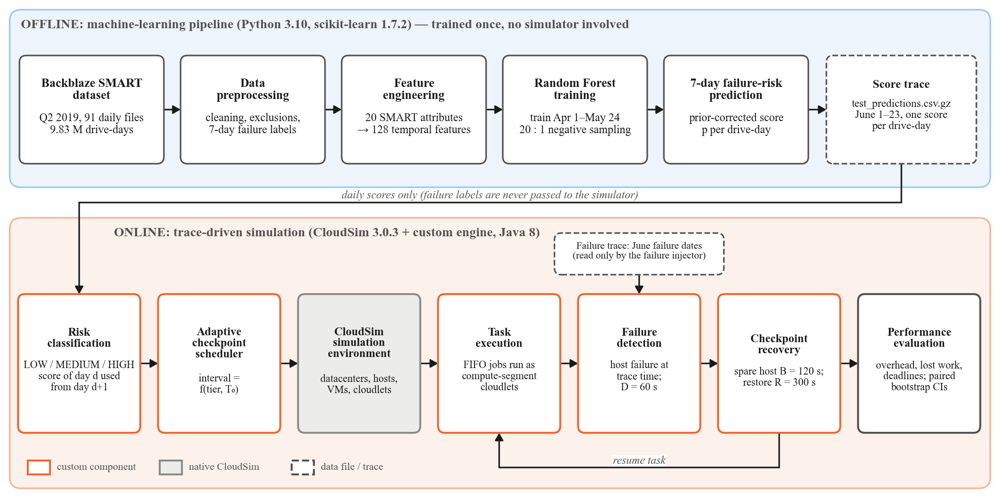
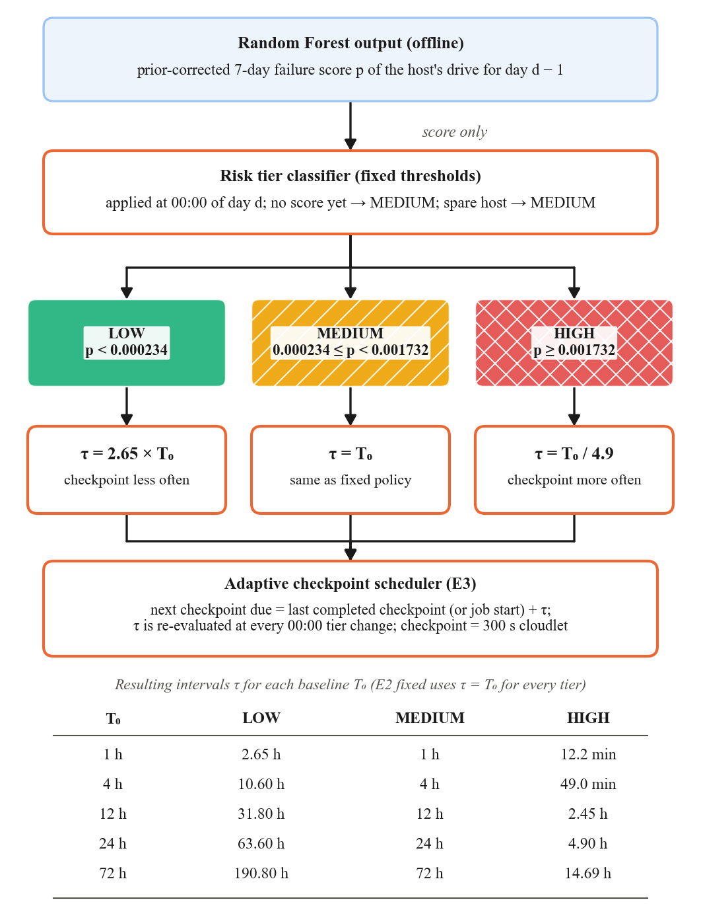
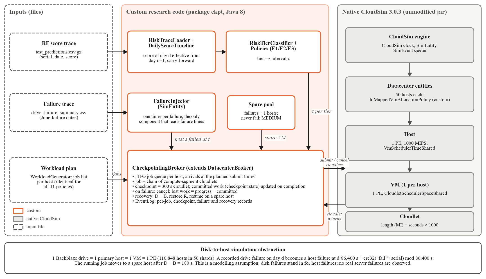
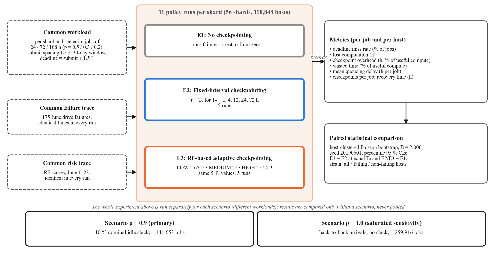

# Predictive Disk Failure-Aware Adaptive Checkpointing for Fault-Tolerant Cloud Task Scheduling

A trace-driven research study that combines a **Random Forest disk-failure predictor**, trained on the public Backblaze Q2 2019 SMART dataset, with a **risk-adaptive checkpoint scheduler** simulated in **CloudSim 3.0.3**. The RF model assigns each simulated host a daily 7-day failure-risk score. The scheduler maps that score to a risk tier and shortens or lengthens the checkpoint interval accordingly. The policy is compared with no checkpointing and with fixed-interval checkpointing, on an identical workload and an identical failure trace.

> **Modelling assumption.** Each Backblaze drive is treated as one simulated host, and a recorded **disk** failure is treated as the failure of that host. This is a trace-driven abstraction, not evidence about real server availability. All results describe this abstraction.

---

## Contents

1. [Research objectives](#1-research-objectives)
2. [System architecture](#2-system-architecture)
3. [Dataset](#3-dataset)
4. [Random Forest prediction methodology](#4-random-forest-prediction-methodology)
5. [Adaptive checkpointing mechanism](#5-adaptive-checkpointing-mechanism)
6. [CloudSim integration](#6-cloudsim-integration)
7. [Experimental configuration](#7-experimental-configuration)
8. [Evaluation metrics](#8-evaluation-metrics)
9. [Results documentation](#9-results-documentation)
10. [Repository structure](#10-repository-structure)
11. [Installation](#11-installation)
12. [Execution](#12-execution)
13. [Validation and reproducibility](#13-validation-and-reproducibility)
14. [Research limitations](#14-research-limitations)
15. [What is not in this repository](#15-what-is-not-in-this-repository)

---

## 1. Research objectives

1. Build a leakage-free 7-day disk-failure prediction target and feature set from raw Backblaze SMART logs, with a fully audited data pipeline.
2. Train and evaluate a Random Forest that outputs a prior-corrected 7-day failure-risk score per drive-day, using strictly chronological train / purge / test splits.
3. Design an adaptive checkpointing policy that uses the predicted risk (not a predicted interval) to scale a base checkpoint interval T₀ per host.
4. Implement failure injection, checkpointing and recovery in CloudSim 3.0.3 without modifying the CloudSim library.
5. Compare **E1** (no checkpointing), **E2** (fixed interval) and **E3** (RF-adaptive) in paired, trace-driven experiments, and report effects with host-clustered bootstrap confidence intervals. No significance testing is claimed.

## 2. System architecture



The pipeline has three stages, each with its own outputs and validation:

| Stage | Location | Output consumed by the next stage |
|---|---|---|
| **1. Data audit and dataset construction** | `project/ml/preprocessing/` | Chronological train / test drive-day tables with 128 features and 7-day labels |
| **2. Random Forest prediction** | `project/ml/training/` | `test_predictions.csv.gz`: one prior-corrected risk score per drive-day for June 1–23, 2019 |
| **3. Trace-driven CloudSim simulation** | `project/cloudsim/research/` | Per-job, per-host and event logs per policy; analysed into `results/full_rho*/analysis/` |

The paper-ready diagrams (Fig. 1–6) are in [`project/paper_assets/architecture/`](project/paper_assets/architecture/):
* system architecture;
* ML pipeline;
* adaptive scheduler;
* CloudSim integration and recovery;
* execution flowchart;
* experimental design.

## 3. Dataset

* **Source:** [Backblaze Hard Drive Data, Q2 2019](https://www.backblaze.com/cloud-storage/resources/hard-drive-test-data), daily SMART snapshots of a production storage fleet. The raw archive is **not** included in this repository (see [§15](#15-what-is-not-in-this-repository)).
* **Size:** 91 daily CSV files (2019-04-01 to 2019-06-30), 9,831,138 drive-days, 111,817 drives across 42 models, 500 failed drives.
* **Audit:** the files were audited and re-validated. Results are in `project/ml/results/dataset_audit*/` and the specification is in [`final_methodology_spec.md`](project/ml/results/dataset_audit/final_methodology_spec.md).
  * The audit found that `2019-06-17.csv`, as distributed inside the official archive, was altered by a spreadsheet program: `M/D/YY` dates and 58,779 values rounded into scientific notation.
  * This file was **not edited**. Instead, the damaged columns are set to NaN for that day, and five drives with inconsistent failure records are excluded.
* **Label:** a drive-day (drive, day *t*) is positive if the drive records a failure on one of days *t*+1 … *t*+7.
* **Chronological split:**

  | Period | Dates | Use |
  |---|---|---|
  | Train | 2019-04-01 to 05-24 | Model fitting and internal time-based validation |
  | Purge | 05-25 to 05-31 | Not used, so no training label window overlaps the test period |
  | Test | 06-01 to 06-23 | Final evaluation, and the risk trace driving CloudSim |
  | Tail | 06-24 to 06-30 | Not used as examples (outcome unknown); used only as label outcomes for test days |

## 4. Random Forest prediction methodology

Full details are in [`project/ml/results/model_evaluation/model_report.md`](project/ml/results/model_evaluation/model_report.md).

* **Features:** 128, all computed from records dated ≤ *t*.
  * Current raw values of 20 SMART attributes.
  * Previous-day values.
  * 1-day and 7-day changes.
  * 7-day mean and standard deviation.
  * "Not reported" flags.
  * History-completeness indicators.

  Missing values stay NaN, and scikit-learn's Random Forest handles them natively. The feature order is in `project/ml/models/feature_order.txt`.
* **Class imbalance:** all positive rows are kept, and negatives are down-sampled to a 20 : 1 ratio. The sampling is deterministic, stratified by date × drive model and uses seed `20190401`.
* **Model selection:** internal time-based validation inside the training period (fit / purge / validation). The grid covers 300 trees, `max_features="sqrt"`, `max_depth` ∈ {10, 20, None} × `min_samples_leaf` ∈ {1, 5, 20}. Selected: `max_depth=20`, `min_samples_leaf=1`.
* **Probability correction:** scores are mapped back to the population prior with *p = βs / (βs + 1 − s)*, where β is the negative sampling fraction.
* **Single use of the test set:** the June test set was scored once, after every choice above was fixed. All 2,544,754 June drive-days were scored without down-sampling.
* **Test results (June 1–23):**

  | Metric | Value |
  |---|---|
  | ROC-AUC | 0.804 |
  | PR-AUC | 0.0337, at a prevalence of 0.039 % |
  | Recall at 1 % FPR | 37.3 % |
  | Failed drives with at least one alarm in the 7 days before failure | 59 of 175 |

  The scores rank risk usefully but are **not reliably calibrated** (model report §6.3).
* **Saved artefacts:** `project/ml/models/random_forest_7d.joblib` (scikit-learn 1.7.2) with `random_forest_7d_metadata.json`.

## 5. Adaptive checkpointing mechanism



* **Risk tiers.** The RF predicts **risk**, not the interval. Each host's daily score is mapped to a tier using thresholds fixed on the **validation** score distribution, at its 90th and 99th percentiles. The thresholds were not tuned on June:

  | Tier | Score range | E3 checkpoint interval |
  |---|---|---|
  | LOW | score < 0.000234 | 2.65 × T₀ |
  | MEDIUM | 0.000234 ≤ score < 0.001732 | T₀ |
  | HIGH | score ≥ 0.001732 | T₀ ÷ 4.9 |

* **Timing and look-ahead.** The score for day *d* takes effect from 00:00 on day *d*+1. Missing days carry the last score forward. A host is MEDIUM before its first score. Labels are never read by the scheduler; the loader throws an error if the label column would be extracted.
* **Recovery.**
  * After a failure, the interrupted job resumes from its last *completed* checkpoint on a spare host, which never fails and is treated as MEDIUM tier.
  * A job with no checkpoint restarts from zero.
  * Costs: checkpoint save C = 300 s, restore R = 300 s, failure detection D = 60 s, replacement boot B = 120 s.

The design rationale, including the Young/Daly analysis and the derivation of the multipliers, is in [`project/cloudsim/ADAPTIVE_CHECKPOINTING_DESIGN.md`](project/cloudsim/ADAPTIVE_CHECKPOINTING_DESIGN.md).

## 6. CloudSim integration



* The **official CloudSim 3.0.3 jar is used unmodified.** All research logic is in the `ckpt` package under `project/cloudsim/research/src/`:

  | Component | Role |
  |---|---|
  | `sim/CheckpointingBroker` | Custom broker: per-host FIFO queues, checkpoint scheduling, interruption, lost-work accounting and recovery onto spare hosts |
  | `sim/FailureInjector` | Injects the recorded June drive failures at `day + crc32("fail\|"+serial) mod 86400` s. Identical for all policies; the only component that reads failures |
  | `policy/Policies`, `policy/RiskTierClassifier` | E1 / E2 / E3 interval rules and tier boundaries |
  | `risk/DailyScoreTimeline`, `trace/RiskTraceLoader` | Daily risk timeline with no look-ahead, built from `test_predictions.csv.gz` |
  | `trace/WorkloadGenerator` | Deterministic synthetic workload, generated once per shard and shared by every policy |
  | `trace/FailureTraceLoader` | Reads failures from `drive_failure_summary.csv` |
  | `sim/SimulationRunner`, `ExperimentRunner` | Runs all policies for one shard and writes outputs |
  | `test/ckpt/ScenarioTests` | 90 hand-calculated scenario checks |

* **Host model:** 1 host = 1 VM = 1 PE at 1000 MIPS, with 50 hosts per datacenter entity.
* **Shards:** the 110,848 June hosts are split into 56 deterministic shards by `crc32(serial_number) % 56`. Shards only partition the host population; they are **not** statistical samples.

Setup and verification of the CloudSim download are documented in [`project/cloudsim/SETUP_LOG.md`](project/cloudsim/SETUP_LOG.md).

## 7. Experimental configuration



| Item | Value |
|---|---|
| Policies | **E1** none; **E2** fixed T₀; **E3** RF-adaptive. T₀ ∈ {1, 4, 12, 24, 72} h, giving 11 configurations |
| Workload | Job lengths 24 / 72 / 168 h (p = 0.5 / 0.3 / 0.2). Submit times `submitⱼ₊₁ = submitⱼ + Lⱼ / ρ` over 30 days. FIFO per host. Deadline = submit + 1.5 L |
| Scenarios | **ρ = 0.9** (primary; 10 % nominal slack) and **ρ = 1.0** (saturated sensitivity) |
| Scale | 110,848 hosts and 175 failure events per scenario; 1,141,653 jobs (ρ = 0.9) and 1,259,916 jobs (ρ = 1.0) |
| Pairing | Every policy in a scenario sees the identical workload, failure times and risk trace |
| Statistics | Paired host-clustered Poisson bootstrap, B = 2,000, seed 20190601, percentile 95 % CIs. Failing and non-failing hosts bootstrapped as separate strata |
| Runtime | Java 8 (1.8.0_501); compiled with `javac --release 8` |

Raw totals are **never compared across ρ**, because the two scenarios have different workloads.

## 8. Evaluation metrics

| Metric | Definition |
|---|---|
| Deadline miss rate | Share of jobs finishing after submit + 1.5 L |
| Lost work | Computation since the last completed checkpoint, lost at each failure |
| Checkpoint overhead | 300 s × completed checkpoint writes. Writes interrupted by a failure count in wasted time, not in overhead |
| Wasted time | Overhead + lost work + interrupted writes + recovery, also as a % of useful compute |
| Queueing delay | Mean time a job waits in its host's FIFO queue |
| Checkpoints per job; turnaround / length | Secondary efficiency measures |
| Tier occupancy | Share of host-days in LOW / MEDIUM / HIGH, overall and for failing hosts |

Each E3 − E2 comparison is reported as an absolute difference, a % of E2, a 95 % CI and the favourable direction. **No p-values are computed and no statistical significance is claimed.** Intervals are not adjusted for multiple comparisons. Lost-work intervals are wide because they rest on 175 failure events.

## 9. Results documentation

This README deliberately does not restate the findings. They, and their caveats, are documented in full in:

* [`project/cloudsim/results/FINAL_EXPERIMENT_REPORT.md`](project/cloudsim/results/FINAL_EXPERIMENT_REPORT.md): full experiment report, covering execution, validation, primary (ρ = 0.9) and saturated (ρ = 1.0) results, risk-tier analysis, limitations and conclusions;
* [`project/ml/results/model_evaluation/model_report.md`](project/ml/results/model_evaluation/model_report.md): RF evaluation report;
* [`project/paper_assets/PAPER_ASSET_REPORT.md`](project/paper_assets/PAPER_ASSET_REPORT.md): paper figures, tables, captions and the numerical consistency audit;
* `project/cloudsim/results/full_rho{0.9,1.0}/analysis/*.csv`: machine-readable policy summaries and paired comparisons with CIs.

## 10. Repository structure

```
.
├── README.md
├── requirements.txt                     Python dependencies (versions used)
└── project/
    ├── ml/
    │   ├── preprocessing/               Dataset audit, provenance check, labels, features, dataset build and validation
    │   │   └── config.py                All approved methodology constants (dates, splits, exclusions)
    │   ├── training/                    RF config, sampling, metrics, training and evaluation script
    │   ├── models/                      random_forest_7d.joblib, metadata JSON, feature order
    │   ├── processed/                   Build and validation logs, split summary, feature manifest
    │   │                                (the large *.csv.gz tables are excluded; regenerate them)
    │   └── results/
    │       ├── dataset_audit/           Original audit and final methodology specification
    │       ├── dataset_audit_revalidation/  Re-audit, provenance, label counts, drive_failure_summary.csv
    │       └── model_evaluation/        Metrics, calibration, importance, model_report.md, test_predictions.csv.gz
    ├── cloudsim/
    │   ├── ADAPTIVE_CHECKPOINTING_DESIGN.md
    │   ├── SETUP_LOG.md
    │   ├── vendor/downloads/SHA256SUMS.txt   Checksums of the official CloudSim 3.0.3 archives
    │   ├── research/
    │   │   ├── src/ckpt/                Broker, failure injector, policies, risk timeline, trace loaders, runners
    │   │   ├── test/ckpt/               ScenarioTests (90 checks)
    │   │   ├── scripts/                 build_and_test.sh, run_pilot.sh, run_full.py
    │   │   └── validation/              validate_pilot.py, validate_full.py, analyze_full.py
    │   └── results/
    │       ├── FINAL_EXPERIMENT_REPORT.md
    │       ├── full_rho0.9/, full_rho1.0/   manifest.csv, run_config.json, shard logs, validation/, analysis/
    │       └── pilot/, pilot_v1_superseded/ Pilot reports and validation summaries
    └── paper_assets/
        ├── PAPER_ASSET_REPORT.md
        ├── scripts/                     Scripts that generate every figure, table and audit
        ├── architecture/                Fig. 1–6 (SVG, PDF, PNG 300 dpi)
        ├── graphs/                      G01–G20 (+ data CSVs behind every plot)
        ├── tables/                      Tables 1–15 as CSV and booktabs LaTeX
        ├── captions/                    Figure and table captions
        ├── evidence/                    Numerical consistency audit, data sources, file inventory
        └── overleaf/                    Standalone IEEEtran preview project with all figures and tables
```

## 11. Installation

**Requirements**

* **Python 3.10** with the packages in `requirements.txt`:
  ```bash
  python -m venv .venv
  .venv/Scripts/activate        # Windows; use source .venv/bin/activate on Linux/macOS
  pip install -r requirements.txt
  ```
* **Java:** a JDK ≥ 9 to compile with `javac --release 8`, and a Java 8 runtime to run. The results were produced with JDK 24 `javac` and JRE 1.8.0_501.
* **Bash:** the shell scripts use `cygpath`, so on Windows run them from Git Bash. The Java paths are set at the top of:
  * `research/scripts/build_and_test.sh`;
  * `research/scripts/run_pilot.sh`;
  * `research/scripts/run_full.py` (`JAVA8`).

  Adjust them to your installation.

**CloudSim 3.0.3** (not redistributed here)

1. Download `cloudsim-3.0.3.zip` from the official release: <https://github.com/Cloudslab/cloudsim/releases/tag/cloudsim-3.0.3>.
2. Verify the checksum against `project/cloudsim/vendor/downloads/SHA256SUMS.txt`:
   ```bash
   sha256sum cloudsim-3.0.3.zip   # expect 966322187fc5eda7088279213bc3b2c3f5edc1adef0734b4457859348689d2fd
   ```
3. Extract it so that the file `project/cloudsim/vendor/cloudsim-3.0.3/jars/cloudsim-3.0.3.jar` exists.

**Backblaze data** (only needed to rebuild the ML stage)

1. Download `data_Q2_2019.zip` from the Backblaze Hard Drive Data page.
2. Place the archive in the repository root.
3. Extract the 91 daily CSVs into `project/dataset/backblaze_q2_2019/`.

## 12. Execution

The scripts locate data relative to the repository root. Run the ML commands from the **repository root** and the CloudSim commands from `project/cloudsim/`.

**Stage 1 and 2: dataset and Random Forest** (needs the Backblaze data; about 13 min for training)

```bash
python -I project/ml/preprocessing/inspect_dataset.py              # dataset audit
python -I project/ml/preprocessing/verify_provenance.py \
       --data project/dataset/backblaze_q2_2019 --zip data_Q2_2019.zip \
       --out project/ml/results/dataset_audit_revalidation          # archive provenance check
python -I project/ml/preprocessing/target_feasibility_counts.py    # label counts
python -I project/ml/preprocessing/build_dataset.py                # features + labels + splits
python -I project/ml/preprocessing/validate_dataset.py             # independent dataset validation
python -I project/ml/training/train_random_forest.py               # train, select, evaluate, score June
```

**Stage 3: CloudSim experiment.** This needs only CloudSim plus the files already in this repository (`test_predictions.csv.gz` and `drive_failure_summary.csv`).

```bash
cd project/cloudsim
bash research/scripts/build_and_test.sh                                        # compile + 90 scenario tests
python -I research/scripts/run_full.py --out results/full_rho0.9 --utilization 0.9 --workers 2
python -I research/validation/validate_full.py results/full_rho0.9 --workers 3
python -I research/validation/analyze_full.py  results/full_rho0.9 --boot 2000 --workers 1
python -I research/scripts/run_full.py --out results/full_rho1.0 --utilization 1.0 --workers 2
python -I research/validation/validate_full.py results/full_rho1.0 --workers 3
python -I research/validation/analyze_full.py  results/full_rho1.0 --boot 2000 --workers 1
```

* `run_full.py` skips shards that are already marked `DONE`. To reproduce from scratch, use a new `--out` folder.
* Each scenario writes about 4.5–5 GB and took about 1.4–1.7 h with two shards in parallel.

**Paper assets** (from `project/paper_assets/scripts/`)

```bash
python make_diagrams.py && python make_rf_graphs.py && python make_result_graphs.py
python make_tables.py && python consistency_check.py && python make_docs.py
```

`consistency_check.py` re-reads the raw per-job outputs, so it needs a completed Stage 3 run. The other scripts need only the files in this repository.

## 13. Validation and reproducibility

* **Determinism.** All randomness is seeded or hash-based (`crc32` of serial numbers), so workloads, failure times, sampling and shards are reproducible.
* **Recorded hashes.** `manifest.csv` records SHA-256 hashes of every shard's inputs and outputs. In each scenario, the two shards with the most failures were re-run from scratch, and all 71 output hashes per shard were identical.
* **Scenario tests:** 90 / 90 hand-calculated checks (`build_and_test.sh`).
* **Pilot:** 19 / 19 checks, including byte-identical output with about 50 % of labels scrambled. This shows that the scheduler does not use labels.
* **Full-run validation** (`validate_full.py`): an independent Python recomputation of every shard. It checks:
  * score timing without look-ahead;
  * the failure trace;
  * workload regeneration;
  * identical job sets across all 11 policies;
  * overhead, lost-work and recovery accounting;
  * FIFO order;
  * the per-job time identity.

  56 / 56 shards pass in both scenarios. Results are in `results/full_rho*/validation/`.
* **Paper-asset audit** (`paper_assets/evidence/numerical_consistency_check.md`): 24 / 24 checks pass. Every plotted and tabulated value is traced back to the analysis files, and the analysis files are recomputed from the raw per-job outputs.
* **ML validation:** `validate_dataset.py` reads the built dataset back and checks it against the raw CSVs and the approved methodology counts. Results are in `project/ml/processed/validation_results.json`.

## 14. Research limitations

These limitations are documented in the experiment and model reports.

1. **Disk-to-host abstraction.** A drive failure stands in for a host failure. The results do not describe real server availability.
2. **Few failure events.** There are 175 failures in the June test period, so lost-work estimates have wide confidence intervals.
3. **Distribution shift.** June risk scores are shifted upward relative to validation. 6.6 % of host-days fall in the HIGH tier against a 1 % design target, which inflates E3's overhead on healthy hosts. The tier thresholds were intentionally not re-tuned on June.
4. **Modest, imperfectly calibrated predictor.**
   * Test PR-AUC is 0.034, and about two thirds of failing drives receive no warning.
   * The probabilities are on the right order of magnitude but not reliably calibrated.
5. **One quarter, one fleet.**
   * Three months of Backblaze data, with failures concentrated in three Seagate models.
   * Most failed drives are left-truncated: 98 % were already running on 1 April.
   * The `2019-06-17` file in the official archive is spreadsheet-altered.
6. **Synthetic workload and fixed costs.**
   * Job mix 24 / 72 / 168 h, FIFO per host, C = R = 300 s, D = 60 s, B = 120 s.
   * Results, especially at ρ = 1.0, depend on the arrival model.
7. **Simulation simplifications.**
   * Spare hosts never fail.
   * Failure time within the day comes from a hash.
   * Risk is updated daily.
   * There is no proactive migration.
8. **Multiplicity.** Many comparisons are reported without adjustment. Isolated intervals that exclude zero should not be read as confirmed effects.

## 15. What is not in this repository

These files are excluded to keep the repository small, or because they are third-party material. They are regenerated or downloaded as described above.

| Excluded | Size | How to obtain |
|---|---|---|
| Backblaze Q2 2019 raw CSVs and archive | about 3.4 GB | Download from Backblaze (§11) |
| Processed chronological train / test tables (`ml/processed/*.csv.gz`) | about 1.8 GB | `build_dataset.py` |
| Per-shard simulation outputs (`results/full_rho*/shard_*/`, pilot run folders) | about 11 GB | `run_full.py` / `run_pilot.sh`. Integrity is checked against `manifest.csv` |
| CloudSim 3.0.3 distribution | about 90 MB | Official release, verified against `SHA256SUMS.txt` |
| Compiled `.class` files | — | `build_and_test.sh` |
| Third-party reference papers (PDF) | — | Copyrighted; obtain from the publishers |

---

**Data attribution:** the hard-drive data is provided by [Backblaze](https://www.backblaze.com/cloud-storage/resources/hard-drive-test-data). **Simulator:** [CloudSim 3.0.3](https://github.com/Cloudslab/cloudsim), CLOUDS Laboratory, University of Melbourne.

**License:** no license has been chosen for this repository yet. Until one is added, all rights are reserved by the author.
